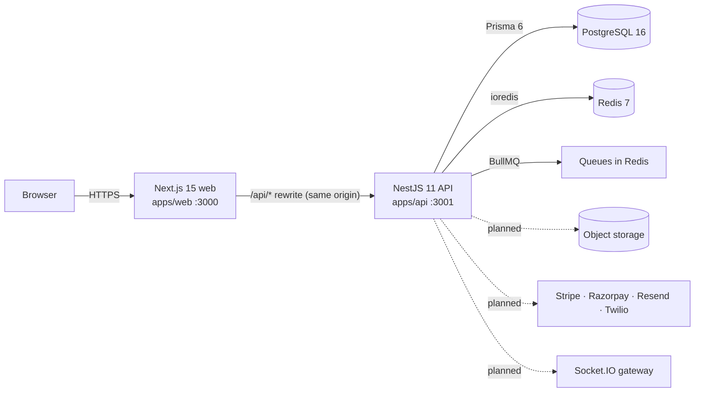
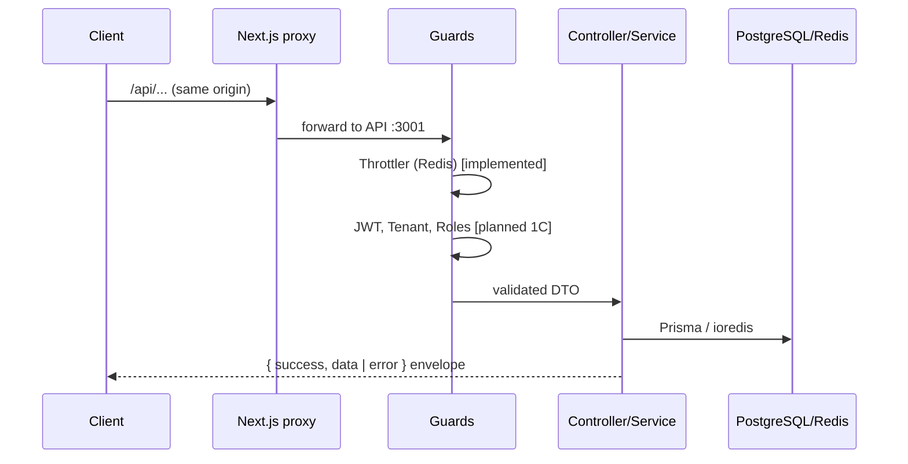
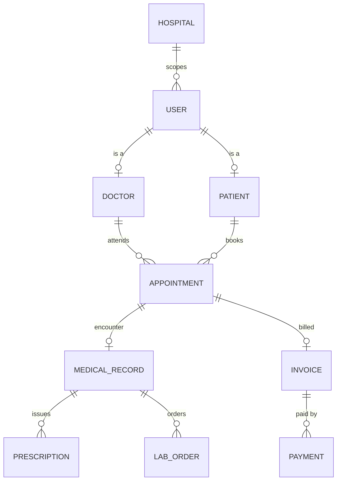

# MedCore HMS — Architecture

Describes the system as it is **implemented**, with planned parts clearly marked **[planned]**.
Detailed plans: [implementation-roadmap.md](implementation-roadmap.md). Database detail:
[database-schema.md](database-schema.md). Decisions: [DECISIONS.md](DECISIONS.md). Last updated 2026-11-16.

## 1. High-level system



| Part | Status |
| --- | --- |
| Monorepo, web, API, shared types, Docker dev stack, CI | Implemented (Phase 0, verified on macOS) |
| Prisma schema (44 models) and database constraints | Written and validated; **not migrated** (DEC-019) |
| Auth, RBAC, tenancy enforcement, all hospital modules | [planned] Phases 1B onward |
| Socket.IO, object storage, payment and messaging providers | [planned] |
| Nginx, production Docker images, AWS/Vercel deployment | [planned] Phase 14 |

## 2. Repository structure (actual)

```text
apps/api            NestJS API
  prisma/           schema.prisma, sql/constraints.sql (migrations: none yet)
  src/common/       filters (error envelope), interceptors (success envelope), logger (sanitiser), pipes (validation), http (PaginatedResult)
  src/config/       env.ts: Zod validation of environment at startup
  src/infra/        prisma, redis, queue (BullMQ), throttler (Redis storage)
  src/modules/      health
  test/             integration tests (*.int-spec.ts), env loader
apps/web            Next.js app
  app/              layout, providers, page (service status), globals.css
  components/       shared/system-status (+ empty ui/, modules/)
  lib/              api-client (envelope-aware fetch), utils (cn)
  services/         health (TanStack Query function)
packages/types      @medcore/types: response envelopes, roles, pagination, health (built to dist/)
packages/config     shared tsconfig.base.json
e2e                 Playwright config (no specs yet)
docker              compose.dev.yml (PostgreSQL 16, Redis 7, Mailpit)
docs                PRD, architecture, rules, design, tasks, memory, test plan, security, decisions, plus reference docs
.github/workflows   ci.yml
```

## 3. Frontend

- Next.js 15.5 App Router, React 19, TypeScript strict, Tailwind CSS 4, Shadcn configuration (`components.json`, no components added yet).
- Server state: TanStack Query (`app/providers.tsx`). Client state: Zustand (installed, no stores yet).
- API access only through `lib/api-client.ts`: same-origin `/api` calls, unwraps the PRD envelope, throws `ApiClientError(code, message, status, details)`; never reports success unless the backend returned `success: true`.
- Styling: design tokens are **not approved yet**; only a functional status page exists (see [DESIGN.md](DESIGN.md)).
- [planned] Route groups `(auth)`, `(dashboard)`, `(portal)` with their first pages in Phase 1D.

## 4. Backend

- NestJS 11 modular monolith. Global setup in `app.setup.ts` (shared by `main.ts` and tests):
  global prefix `/api`; trust proxy; Helmet (CSP relaxed only for `/api/docs`); cookie-parser; CORS allow-list;
  `ValidationPipe` (whitelist, forbid unknown, transform); `AllExceptionsFilter`; `EnvelopeInterceptor`; Swagger at `/api/docs` (`/api/docs/openapi.json`).
- Startup refuses invalid configuration (`config/env.ts`): URLs, CORS list, JWT secrets ≥ 32 chars, not placeholders, access ≠ refresh.
- Logging: `AppLogger` sanitises passwords, tokens, OTPs, secrets, cookies, API keys and bearer tokens.
- Implemented endpoint: `GET /api/health` (200 when PostgreSQL, Redis and the queue respond; 503 with details otherwise).
- [planned] Modules per roadmap: auth, users, hospitals, departments, doctors, patients, availability, appointments, emr, prescriptions, lab, pharmacy, billing, payments, notifications, files, analytics, search, audit.

### Request pipeline



## 5. API communication

- REST under `/api`, PRD envelopes (API-002..004), types shared from `@medcore/types`.
- Error codes: `VALIDATION_ERROR`, `UNAUTHENTICATED`, `FORBIDDEN`, `NOT_FOUND`, `CONFLICT`, `RATE_LIMITED`, `SERVICE_UNAVAILABLE`, `INTERNAL_ERROR` plus module codes. 5xx messages never leak internals.
- Pagination: `PaginatedResult.of(items, total, page, limit)` produces `meta`.

## 6. Authentication and authorisation [Phase 1B and 1C implemented]

- Global guards in order: Throttler (general 1000/min; auth 100/15 min on `@AuthRateLimit()` controllers) →
  `CsrfGuard` (double-submit `mc_csrf` cookie + `x-csrf-token` header on every state-changing request;
  `@SkipCsrf()` only for signed webhooks) → `JwtAuthGuard` (Bearer access token; `@Public()` opts out) →
  `TenantGuard` (puts the principal in the request's AsyncLocalStorage context; 404 for a `hospitalId`
  param/query naming another hospital, configurable with `@TenantParam()`) → `RolesGuard` (`@Roles()`);
  then `AuditInterceptor` (every successful write, plus Super Admin cross-tenant reads). The pipeline is
  defined once in `common/global-pipeline.ts`.
- Access JWT (HS256, 15 min, claims `sub`, `sid`, `role`, `hid`, `typ: access`) is kept in memory by the web
  app. The refresh JWT (7 days, `jti`, `typ: refresh`) lives only in the httpOnly SameSite=Strict cookie
  `mc_rt` scoped to `/api/auth`. Redis `rt:{userId}:{sessionId}` holds the current `jti`; rotation is an
  atomic Lua compare-and-set and a replayed token revokes all of the user's sessions. Every authenticated
  request also checks that its session exists, so logout and password reset take effect immediately.
- OTPs: 6 digits, HMAC in Redis (`otp:{email|phone}:{userId}`), 10 min, 5 attempts, 60 s cooldown. Email goes
  through the SMTP adapter (Mailpit locally); SMS through `SMS_ADAPTER` (dev inbox locally, Twilio REST in
  production). Reset tokens: random 256-bit, stored as SHA-256 `pwreset:{hash}` for 30 min, single use.
- Code: `common/auth/*` (guards, decorators, token service, session store), `modules/auth/*` (controller,
  service, OTP, passwords, DTOs), `infra/messaging/*` (adapters), `modules/audit/*` (audit writer),
  `cli/create-super-admin.ts` (DEC-013). Contracts and the role→permission list are in `@medcore/types`
  (`auth.ts`). Decisions: DEC-010..013, DEC-026..028.

## 6a. Feature modules (Phase 2)

`modules/hospitals` (onboarding, verify/suspend, profile + billing settings), `modules/departments`,
`modules/staff`, `modules/doctors` (departments, signature via `infra/storage`), `modules/patients` (MRN,
reception registration, patient self-read), `modules/facilities` (rooms, beds). All use
`TenantPrismaService`, `@Roles()`, `@Audit()` and shared DTO fields (`common/dto/fields.ts`); Prisma errors map
to envelopes in `common/http/prisma-errors.ts`. Contracts: `@medcore/types` `org.ts`. Web screens live in
`apps/web/components/org/*` on a shared DataTable, Dialog (Radix), Toaster and SearchInput.

## 6b. Appointments (Phase 3)

`modules/appointments`: `SchedulingService` behind two controllers. `AvailabilityController` serves
`/doctors/:id/schedules`, `/schedules/:id`, `/doctors/:id/exceptions`, `/exceptions/:id` and
`/doctors/:id/slots`; `AppointmentsController` serves `/appointments` (book, list, get, status,
reschedule). Times are hospital-local (`common/time/zoned.ts`, Intl-based, DST-safe). Booking:
transaction → `UPDATE doctor` row lock → overlap re-check → insert; the exclusion constraints
`appointments_doctor_no_overlap` (EMERGENCY excluded) and `appointments_patient_no_overlap` are the final
guard and map to 409. Reminders: `@Global RemindersModule` with queue `appointments`, jobs
`reminder:{id}:{24h|1h}` processed by `ReminderProcessor` (email; SMS to verified phones). Contracts:
`@medcore/types` `appointments.ts`. Web: `components/appointments/*` (slot picker, booking form,
staff agenda, availability, patient portal), all times shown in the hospital time zone (DEC-038).

## 6c. Medical records (Phase 4)

`modules/emr`: `EmrService` behind `MedicalRecordsController` (`/medical-records`, `/medical-records/record/:id[/entries|vitals|diagnoses|files]`, `/medical-records/:patientId`), `ClinicalFilesController` (`/files/:id`), `PatientHistoryController` (`/patients/:patientId/history|allergies|medications|vaccinations|family-history`, status changes) and `Icd10Controller`. Encryption: `infra/crypto/field-crypto.ts` (`FIELD_CRYPTO`), two parameterised pgcrypto queries that batch a request's values into one round trip. Reads of clinical routes are audited with `@AuditRead`. Web: `components/emr/*` (encounter start, record view, history panel, chart) on `/dashboard/encounters/:appointmentId`, `/dashboard/records/:id`, `/dashboard/patients/:id`, `/portal/health`, `/portal/records/:id` (DEC-039).

## 7. Tenant isolation

Row-per-tenant (shared schema) with three layers (TEN-001..005, DEC-018):
1. **Database:** every hospital-specific table has `hospitalId`; tenant relations are composite
   `(id, hospitalId)` foreign keys, so a row can never reference another hospital's row.
2. **Query layer:** `TenantPrismaService.client` (`common/tenancy/`) is a Prisma query extension that forces
   `hospitalId` into every where clause and create, and rejects tenant changes (`scopeArgs`). Other
   hospitals' rows do not exist for the caller (404). Super Admins get the unscoped client; the request is
   flagged and audited. Outside an authenticated request the client throws.
3. **Request layer:** `hospitalId` comes only from the verified access token; `TenantGuard` rejects URLs
   naming another hospital.
Verified by the tenancy unit tests, the users isolation tests and `test/tenancy.int-spec.ts` (PostgreSQL).

## 8. Database

PostgreSQL 16 via Prisma 6.19. 44 models, 36 enums; key mechanisms: exclusion constraints against double
booking, CHECK constraints for billing integrity and data ranges, append-only and lock triggers for clinical
data, deferred role/profile triggers, pgcrypto for encrypted columns. Full description, PRD cross-check and
four ER diagrams: [database-schema.md](database-schema.md). Migration workflow: DEC-025.



## 9. Redis, caching and background jobs

- Implemented: shared ioredis client; Redis rate-limit counters (atomic Lua); BullMQ connection with prefix `medcore` and one `system` queue used by the health check.
- Implemented (Phase 1B/3): refresh-token sessions, OTPs; slot cache `slots:{doctorId}:{date}` for 60 s, cleared by SCAN on changes; queue `appointments` with delayed reminder jobs.
- [planned] inventory counts; queues `email`, `sms`, `push`, `pdf`, `reports`; nightly expiry scan.

## 10. Real-time, files and external integrations [planned]

Socket.IO gateway with JWT handshake and `user:{id}` / `hospital:{id}` rooms; file uploads (Multer + Sharp,
20 MB, MIME + extension checks) to S3-compatible storage; provider adapters for Stripe, Razorpay, Resend,
Twilio with local implementations (DEC-003).

## 11. Environments, deployment and CI

- Local: Node 24, pnpm 11, Docker Desktop; `docker/compose.dev.yml` (ports bound to 127.0.0.1); root `.env` (git-ignored) validated at startup.
- CI (`.github/workflows/ci.yml`, not yet run on GitHub): PostgreSQL and Redis services; install, Prisma generate/validate, format, lint, typecheck, unit tests, integration tests, build.
- [planned] Phase 14: production Compose, API Dockerfile, Nginx with TLS, AWS EC2 + managed PostgreSQL, Vercel, Sentry, release workflow.

## 12. Major architectural decisions

DEC-004 (same-origin proxy), DEC-005 (Node 24 / pnpm 11), DEC-007 (row-level tenancy), DEC-014 (library
versions), DEC-016..018 (corrections, gap fixes, composite tenant keys), DEC-020 (concurrency), DEC-023 (Redis
rate limiting), DEC-024 (pgcrypto helpers), DEC-025 (migrations on macOS).
