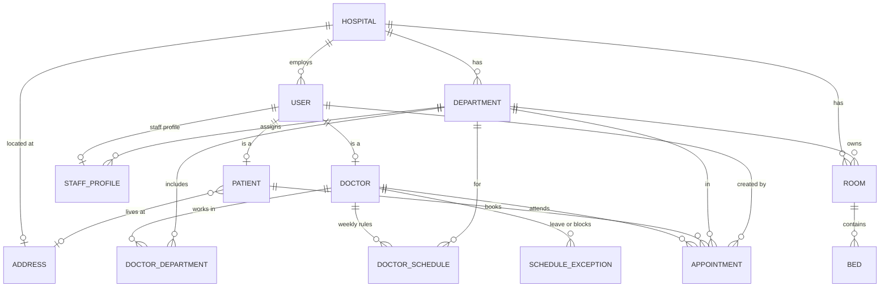
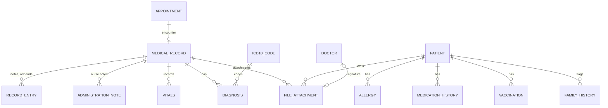
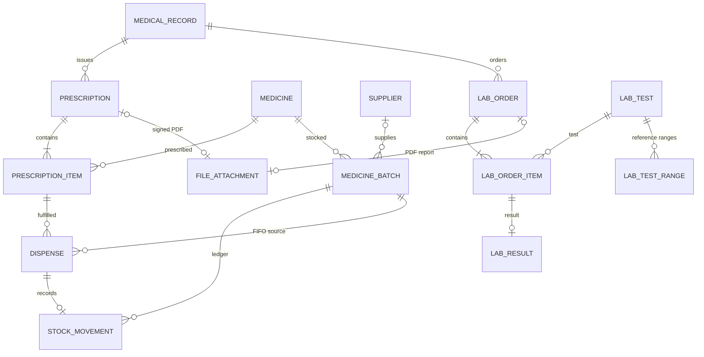
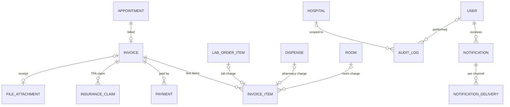

# MedCore HMS Database Schema

Status: **draft for review** (Phase 1A, 2026-11-16). Not yet migrated.
Source of truth: [`apps/api/prisma/schema.prisma`](../apps/api/prisma/schema.prisma) (44 models, 35 enums)
and [`apps/api/prisma/sql/constraints.sql`](../apps/api/prisma/sql/constraints.sql).
Validated with `prisma validate` (Prisma 6.19.3).

## PRD consistency check

| PRD requirement | Where it is met |
| --- | --- |
| Normalised to 3NF (section 05) | Derived values not stored: BMI, a prescription's patient/doctor, dispensed quantity, invoice patient. Exceptions below |
| `hospitalId` on every hospital-specific table (section 03) | All 41 tenant tables. Global tables: `icd10_codes`, `webhook_events`; `users`, `notifications`, `audit_logs` nullable for SUPER_ADMIN |
| Hospital 1-many User, Department, Room | `users`, `departments`, `rooms` |
| Doctor and Patient one-to-one with User | `doctors.userId`, `patients.userId` unique |
| Doctor works in one or more departments (7.2) | `doctor_departments` |
| Appointment many-to-one Doctor, Patient, Department | `appointments` |
| One Appointment, one MedicalRecord; one Appointment, one Invoice | `medical_records.appointmentId`, `invoices.appointmentId` unique |
| Prescription to Medicine many-to-many with per-item dosage | `prescription_items` |
| One MedicalRecord, many LabOrders | `lab_orders.medicalRecordId` |
| InvoiceItem from lab, pharmacy, consultation, room | `invoice_items` with real FKs per kind |
| Notification polymorphic linked entity; AuditLog any entity | `entityType` + `entityId` |
| Soft delete Patient, Doctor, Appointment; records never deleted | `deletedAt`; triggers block deletes |
| Separate reusable Address | `addresses` used by hospitals, patients, suppliers |
| EMR data points (7.3) incl. **medication history** | vitals, diagnoses + ICD-10, allergies/ADR, vaccinations, family history flags, `medication_history`, attachments |
| Encrypted diagnosis and notes (section 10) | `*Enc` bytea columns, pgcrypto |
| No double booking; patient cannot overlap (7.2) | Exclusion constraints in the database |
| Batch fields, FIFO, expiry quarantine, reorder level (7.6) | `medicine_batches`, `stock_movements`, `medicines.reorderLevel` |
| Invoice total equals line items (11) | CHECK constraints; subtotal recomputed in the same transaction as item changes |
| Minimum indexes: hospitalId, patientId, doctorId, appointment date | Present, plus composite indexes for list queries |

### Points flagged for your awareness

1. **3NF vs `hospitalId` everywhere.** The PRD asks for both. On child tables (for example
   `prescription_items`) `hospitalId` is reachable through the parent, so storing it is a
   transitive dependency. I followed the explicit tenancy rule because tenant scoping on every
   query depends on it.
2. **Medication history was missing from the roadmap.** The PRD (Week 2) lists "allergy and
   medication history". Added `medication_history`. Not a new feature.
3. **Deliberate denormalisations:** invoice totals (needed for the billing-integrity
   requirement, guarded by CHECKs) and `medicine_batches.quantity` (current stock, kept equal to
   the `stock_movements` ledger in one transaction).
4. **PRD "never use raw()" vs pgcrypto.** Encryption needs SQL functions Prisma does not expose.
   Phase 4 adds two parameterised helpers (approved roadmap default C2). The constraints in this
   document are migrations, not runtime raw queries.
5. **Not stored in PostgreSQL by design:** refresh tokens, OTPs and password-reset tokens live in
   Redis with expiry (PRD 7.1).

## Entity relationship diagrams

### Tenancy, people and scheduling

### Electronic medical records

### Prescriptions, pharmacy and laboratory

### Billing, notifications and audit

`webhook_events` (payment replay protection) stands alone, keyed by provider and event id.

## Database-enforced rules (constraints.sql)

| Rule | Mechanism |
| --- | --- |
| Only SUPER_ADMIN has no hospital | CHECK |
| Email unique ignoring case | Unique index on `lower(email)` |
| A doctor is never double-booked (except EMERGENCY) | `EXCLUDE USING gist` on doctor + time range |
| A patient never has overlapping appointments | `EXCLUDE USING gist` on patient + time range |
| Valid schedule windows, slot length 5 to 240 min | CHECK |
| Plausible vitals; files at most 20 MB | CHECK |
| Stock never negative; expiry after manufacture | CHECK |
| Invoice: total = subtotal + tax - discount; line total = quantity x unit price; item links match kind | CHECK |
| Cash payments have no provider; card/UPI/netbanking do | CHECK |
| Record entries, nurse notes, diagnoses, vitals, audit log: never updated or deleted | Triggers |
| Medical records and lab results never deleted | Triggers |

Double booking is blocked by the database even if application code has a bug. The booking
service (Phase 3) also locks rows and returns `409 SLOT_UNAVAILABLE` cleanly.

## Migration workflow

Prisma's migration engine cannot run in the build VM, so migrations are created on macOS:

1. `pnpm --filter @medcore/api prisma:migrate:create --name init` creates the SQL without applying it.
2. The contents of `prisma/sql/constraints.sql` are appended to that migration file and reviewed.
3. `pnpm --filter @medcore/api prisma:migrate` applies it to the local database.
4. Applied migrations are never edited; later changes get new migrations.
5. Production uses `prisma migrate deploy` only.
